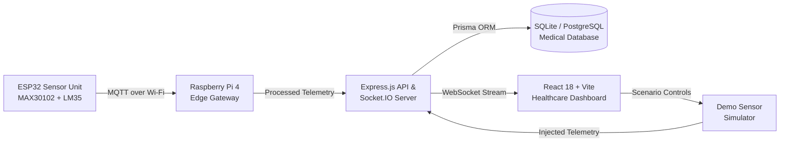

# LNMIIT Smart Healthcare System
### IoT-based Smart Healthcare Monitoring & Patient Management System
**LNM Institute of Information Technology (LNMIIT), Jaipur &bull; Mini-Project**

---

## 🏥 Project Overview
The **LNMIIT Smart Healthcare System** is an end-to-end IoT patient monitoring and clinical management platform designed for the campus medical room. The system captures physiological vital signals (Heart Rate, Blood Oxygen Saturation $\text{SpO}_2$, and Body Temperature) using **MAX30102** and **LM35** sensors connected to **ESP32** microcontrollers.

The sensor data is transmitted over campus Wi-Fi via **MQTT** to a **Raspberry Pi Edge Gateway**, processed for physiological motion artifacts, evaluated against clinical triage thresholds, and broadcast via **WebSockets (Socket.IO)** to a modern **React** healthcare dashboard.

### Core Objectives & Highlights
* **Real-time Vital Monitoring**: Continuous dual-bed telemetry (Bed 1 & Bed 2) updating at 2-second intervals without page reloads.
* **Role-Based Access Control (RBAC)**: Secure isolation across **Admin**, **Doctor**, and **Student/Patient** roles.
* **Emergency Triage Engine**: Immediate emergency alert modal and audio-visual beacon when critical limits are breached ($\text{SpO}_2 < 90\%$, $\text{Heart Rate} > 150 \text{ or } < 40\text{ BPM}$, $\text{Temp} > 39.4^\circ\text{C}$).
* **Digital Medical Profiles & History**: Comprehensive patient longitudinal history, past symptoms, and physiological baselines.
* **Digital Prescriptions & Clinical Notes**: Multi-item medication issuance, doctor clinical observations, and follow-up tracking.
* **AI Medical Report Summarizer**: Automatic extraction of findings, abnormal metrics, concerns, and doctor questions from uploaded PDF lab reports.
* **AI Student Health Assistant**: Triage chatbot with context awareness of the student's recent vitals and strict medical safety disclaimers.
* **Interactive Demo Simulator**: 1-click live simulation switching between **Normal**, **Monitor**, **Attention**, and **Emergency** scenarios with transparent hardware vs. simulation badging.

---

## 🧑‍⚕️ Pre-Configured Demo Accounts

For evaluation and demonstration, use these accounts with one-click quick-fill buttons on the login page:

| Role | Email Address | Password | Name & Details |
| :--- | :--- | :--- | :--- |
| **Admin** | `admin@lnmiit.ac.in` | `admin123` | Prof. R. S. Rathore (System Administrator) |
| **Doctor** | `dr.sharma@lnmiit.ac.in` | `doctor123` | Dr. Alok Sharma (General Medicine &bull; DOC-MED-01) |
| **Doctor** | `dr.verma@lnmiit.ac.in` | `doctor123` | Dr. Sunita Verma (Cardiology &bull; DOC-CARD-02) |
| **Doctor** | `dr.mehta@lnmiit.ac.in` | `doctor123` | Dr. Rajesh Mehta (Orthopedics &bull; DOC-ORTH-03) |
| **Doctor** | `dr.kapoor@lnmiit.ac.in` | `doctor123` | Dr. Priya Kapoor (Neurology &bull; DOC-NEUR-04) |
| **Student** | `student.aarav@lnmiit.ac.in` | `student123` | Aarav Patel (Roll: `21UEC045` &bull; 4th Year ECE) |
| **Student** | `student.ananya@lnmiit.ac.in` | `student123` | Ananya Gupta (Roll: `22UCS102` &bull; 3rd Year CSE) |
| **Student** | `student.rohan@lnmiit.ac.in` | `student123` | Rohan Verma (Roll: `23UME015` &bull; 2nd Year ME) |
| **Student** | `student.ishita@lnmiit.ac.in` | `student123` | Ishita Sen (Roll: `24UCC028` &bull; 1st Year CCE) |

---

## ⚡ Quick Start Guide (Local Execution)

### Prerequisites
* **Node.js** (v18 or higher recommended, tested on Node v24)
* **npm** (v9 or higher)

### Step 1: Install Dependencies & Initialize Database
```bash
# In the project root:
npm run setup:backend
npm run setup:frontend
```
> **Note**: Database models and migrations use SQLite by default (`backend/dev.db`), requiring **zero** external database installations. To connect to an external PostgreSQL database, update `provider = "postgresql"` in `backend/prisma/schema.prisma` and specify `DATABASE_URL` in `.env`.

### Step 2: Start Backend Server
```bash
npm run start:backend
```
* Backend starts at `http://localhost:5000`
* WebSocket (Socket.IO) server enabled
* Built-in ESP32 sensor simulator begins 2-second heartbeat loop

### Step 3: Start Frontend Dev Server
In a second terminal window:
```bash
npm run start:frontend
```
* Frontend starts at `http://localhost:5173`
* Open your browser and navigate to `http://localhost:5173`

---

## 🔄 Real-Time IoT & Telemetry Architecture



### Sensor Mapping
* **MAX30102**: Optical pulse-oximetry sensor measuring resting **Heart Rate (BPM)** and **$\text{SpO}_2$ percentage**.
* **LM35**: Precision analog sensor providing linear output proportional to **Body Temperature ($^\circ\text{C}$)**.

### ESP32 JSON Payload Specification
```json
{
  "bedNumber": 1,
  "heartRate": 84.5,
  "spo2": 98.2,
  "temperature": 37.1,
  "macAddress": "24:6F:28:B4:E1:01",
  "timestamp": 1723456789000
}
```

---

## 🚨 Emergency Triage Thresholds
The system contains a deterministic rule-based medical triage engine:

| Metric | Normal Range | Attention Range | Critical Emergency | Clinical Implication |
| :--- | :--- | :--- | :--- | :--- |
| **Heart Rate** | 60 – 100 BPM | 100 – 120 or 50 – 60 BPM | **$> 150$ or $< 40$ BPM** | Severe Tachycardia / Extreme Bradycardia |
| **Blood $\text{SpO}_2$** | 95 – 100% | 90 – 94% | **$< 90.0\%$** | Acute Hypoxemia |
| **Temperature** | 36.5 – 37.5°C | 37.6 – 39.4°C | **$> 39.4^\circ\text{C}$ ($> 102.9^\circ\text{F}$)** | Severe Hyperpyrexia |

---

## 🤖 AI Features & Medical Ethics Guardrails
* **AI Medical Report Summarizer**: Analyzes uploaded diagnostic PDFs and generates plain-language findings, abnormal value highlights, potential concerns, and questions for the physician.
* **AI Student Health Assistant**: Conversational health guide contextualized with the student's recent monitoring session vitals.
* **Personalized Health Insights**: Rule-based longitudinal trend engine evaluating heart rate drift and temperature response over stored sessions.
* **Safety Mandate**: All AI features prominently feature the mandatory disclaimer:
  > *"AI-generated summary. This is not a medical diagnosis. Please consult a qualified doctor for interpretation."*

---

## 📂 Project Structure
```
smart-healthcare/
├── backend/
│   ├── prisma/
│   │   ├── schema.prisma      # Database models (15 entities)
│   │   └── seed.js            # Realistic campus seed data
│   ├── src/
│   │   ├── middleware/        # JWT & RBAC authorization
│   │   ├── routes/            # REST API endpoints
│   │   ├── services/          # Simulator, risk engine & AI summarizer
│   │   └── server.js          # Express app & Socket.IO server
│   └── uploads/               # Secure directory for PDF medical reports
├── frontend/
│   ├── src/
│   │   ├── components/        # Gauges, charts, modals, navbar, sidebar
│   │   ├── context/           # AuthContext & VitalsContext
│   │   ├── layouts/           # AppLayout with persistent alert modal
│   │   └── pages/             # Admin, Doctor, and Student role portals
│   ├── index.html
│   └── vite.config.js
├── edge-service/              # Raspberry Pi Edge Gateway scripts
│   ├── mqtt_client.py
│   ├── processing.py
│   ├── risk_engine.py
│   └── local_buffer.py
├── nlp-service/               # Python Bio-NLP microservice
│   ├── main.py
│   ├── chatbot.py
│   └── summarizer.py
├── docker-compose.yml
├── README.md
└── package.json
```

---

## 🎓 Academic Presentation Tips
1. **Show Bed Available -> Start Session**: Start a monitoring session for *Aarav Patel* on Bed 2 and observe the live telemetry card populate instantly.
2. **Switch Simulator Scenarios**: Use the top bar to switch from `Normal` to `Emergency` on Bed 1. Watch the red emergency beacon and modal pop up in real time with vital snapshots.
3. **Acknowledge Alert**: Click *Acknowledge Alert* to log doctor review into the audit database.
4. **Demonstrate AI Summarizer**: Navigate to *Medical Reports* in the student portal to review the CBC or ECG AI analysis.
5. **Demonstrate AI Assistant**: Ask the student assistant: *"I have a 39 degree fever and rapid pulse"* to demonstrate the automatic urgency triage and campus emergency referral.

---
**The LNM Institute of Information Technology, Jaipur &bull; Mini-Project 2026**
